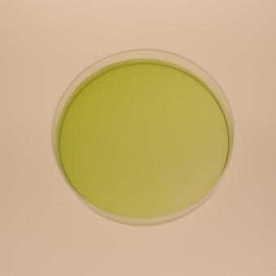
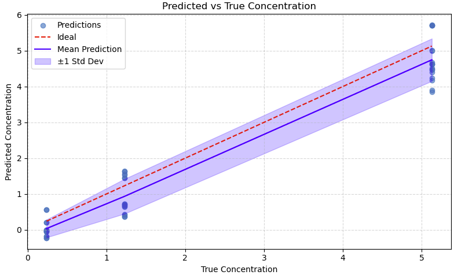

# Proof of Principle: Sensor Fusion for Biomass Estimation

## Overview

This project investigates the feasibility of estimating biomass concentration using non-invasive optical measurements and machine learning.

The proof of principle demonstrates that biomass concentration can be predicted from image data without relying on direct, invasive measurements. The approach combines Convolutional Neural Networks (CNNs) for image processing with a meta neural network for processing additional measurement metadata.

The initial experiments were conducted using algae biomass samples with different concentrations captured in Petri dishes.

**The key objective was to demonstrate the predictability of biomass concentration based solely on non-invasive image data.**

## Project Objectives

- Investigate the feasibility of non-invasive biomass concentration estimation.
- Develop a machine learning approach for extracting relevant information from optical image data.
- Combine image features and measurement metadata using a sensor fusion architecture.
- Evaluate prediction performance on previously unseen data.
- Establish a foundation for further data collection and model optimization.

## Dataset

The first experimental series consisted of images of Petri dishes filled with algae biomass at different concentrations.

| Dataset characteristic | Value |
|---|---:|
| Total images | 159 |
| Different biomass concentrations | 13 |
| Sample material | Algae biomass |
| Image source | Petri dish photography |
| Target variable | Biomass concentration [g/l] |

The dataset was used to investigate the relationship between optical image characteristics and the corresponding biomass concentration.

## Model Architecture

A sensor fusion approach was implemented to combine image-based information with additional measurement metadata.

The architecture consists of the following components:

### 1. Image Processing – CNN

A Convolutional Neural Network (CNN) processes the input images and extracts relevant visual features associated with biomass concentration.

### 2. Metadata Processing – Meta Neural Network

Additional experimental metadata is processed separately using a meta neural network.

Examples of metadata include:
- Probe volume
- Camera settings

### 3. Sensor Fusion and Regression

The extracted image features and processed metadata are combined in a meta-regressor architecture.

The combined information is passed through regression layers to generate the final biomass concentration prediction.

**Target variable:** Biomass concentration in g/l.

## Training Methodology

The model was trained using the initial experimental dataset.

| Parameter | Value |
|---|---:|
| Training epochs | 500 |
| Training hardware | GPU |
| Approximate training duration | 5 minutes |
| Prediction task | Regression |
| Evaluation metric | Mean Absolute Error (MAE) |

The dataset was divided into training and test data to evaluate the model's ability to predict biomass concentrations on unseen samples.

## Results

The proof of principle demonstrated that biomass concentration can be estimated from optical image data.

The following prediction errors were achieved:

| Evaluation | Mean Absolute Error (MAE) |
|---|---:|
| Training data | 0.357 g/l |
| Unseen test data | 0.504 g/l |

MAE (Mean Absolute Error) measures the average absolute difference between predicted and actual biomass concentrations. Lower values indicate better prediction accuracy.

### Key Findings

- The model successfully learned a relationship between optical image data and biomass concentration.
- Biomass concentration could be predicted without direct measurement of the sample.
- The test results indicate that the learned relationship also provides predictive capabilities on previously unseen data.
- The initial results establish the feasibility of the proposed machine learning approach.

## Limitations

The results should be interpreted as an initial proof of principle rather than a fully optimized biomass estimation solution.

The following limitations were identified:

- **Limited dataset:** The initial dataset consists of only 159 images across 13 different biomass concentrations.
- **No model optimization:** No specific model optimization steps were performed to improve prediction accuracy.
- **Limited generalization assessment:** Generalization capabilities cannot be reliably evaluated based on a single experimental test series.
- **Experimental scope:** The initial investigation was limited to algae biomass samples captured in Petri dishes.

## Conclusion

This project successfully demonstrated the feasibility of estimating algae biomass concentration using machine learning and non-invasive optical image data.

By combining CNN-based image processing with metadata processing in a sensor fusion architecture, the model achieved a test MAE of **0.504 g/l** on unseen data.

Although further data collection, model optimization, and independent validation are required, the results provide a promising foundation for developing optical, non-invasive biomass estimation systems.